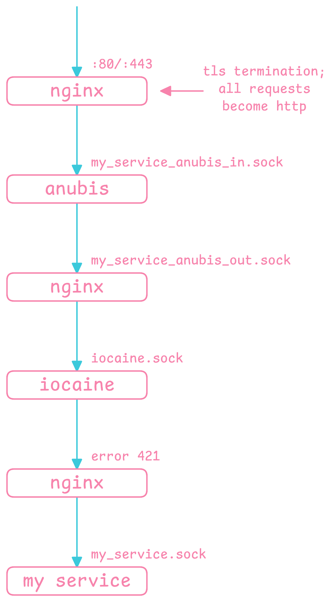

# main server

config/infra for services on main server :3

this is meant to be a semi-reusable docker compose project built out of somewhat-more-reusable docker compose subprojects. most changes you need to make to reuse these modules should be in `.env` files (e.g. relative paths, uids/gids, and the like); i tried my best to modularize them but the proxy, by design, still has to couple with the services somehow (and docker compose seems a bit limited, e.g. not being able to control what `.env` files to use for yaml interpolation from within the compose file itself). deployment should be handled via the scripts provided.

and, to docker compose: you really are a cool concept, but sincerely, from the deepest depths of my heart, fuck you.

## infra overview
- traffic for a service usually takes the following path, with nginx being a reverse proxy:

    

- anubis should have one separate instance per service in order to write service-specific filtering rules, whereas iocaine is a single server-wide instance for simplicity. the [./proxy/anubis/](./proxy/anubis) subproject is the BASE anubis setup that each service's anubis instance should build off of.

## first time setup guide

- make sure docker is installed and enabled as a systemd service.
- write all the files that have a `.example` such that it is correct for your setup (e.g. write an `.env` file for every `.env.example` and a `Dockerfile.dockerignore` for every `Dockerfile.dockerignore.example`), and make sure all the "SYNC" comments in every file in the project are checked.
- add in all gitignored secrets like anubis private keys (just look around in `.env.example`s or `.gitignore`s for them ig).
- make sure bind mounts have the right perms on the host for the containers to access them!
- certbot instructions (currently i do not have a dockerized certbot since it's probably kinda complicated and i need to do actual Important Things, so these instructions will be for running certbot on the host):
    1. first tweak the nginx config for the service you want to certbot to accept http on port 80, and include the [./proxy/nginx/data/templates/snippets/acme_challs.func](./proxy/nginx/data/templates/snippets/acme_challs.func) snippet inside the `server` block. this ensures that acme challenge paths are immediately served by nginx (which also gives us the bonus of not having to worry about anubis etc. filtering it out).
    2. start the nginx container.
    3. on the host, run `certbot certonly --webroot -w <acme challs directory> -d <site domain>`; `<acme challs directory>` must be the same path (like `/var/www/certbot/`) specified in [./proxy/nginx/data/templates/snippets/acme_challs.func](./proxy/nginx/data/templates/snippets/acme_challs.func).
    4. once certbot has generated the certificate, change the nginx config back to the usual with 443, manually adding in certs and stuff if needed since the host's certbot can't automatically tweak nginx config that's in a container.
    5. IMPORTANTLY, also make sure that you give `750` perms to all certificates and that it has nginx's (worker process) group, as otherwise nginx won't be able to access them. i recommend running a `chown -R 0:101 /etc/letsencrypt/` (or whatever the `$DOCKER_ROOT_USER` env var is) and `chmod -R 750 /etc/letsencrypt/` since iirc the certs in `/etc/letsencrypt/live/` are actually symlinks to `/etc/letsencrypt/archive/` or whatever. to make sure certbot autorenewals don't revert this, ALSO copy [./proxy/nginx/deployment_reference/nginx_handle_certbot_renewal.sh](./proxy/nginx/deployment_reference/nginx_handle_certbot_renewal.sh) to `/etc/letsencrypt/renewal-hooks/deploy/`!
- run `deploy.sh` in the appropriate project directory to start or restart the containers. the `deploy.sh`s found in some subproject should allow you to deploy or restart that subproject independently. in production, you probably want to use a systemd service to run these scripts (at least the main server one; trying to make the others independent systemd services might be tricky).
- set up and enable systemd services as necessary (deployment, backups, etc.).
- additional recommendations:
    - make all `.env` and secrets files (like anubis private keys) owned by root/your docker user on the host and have `600` perms; or owned by the `$DOCKER_ROOT_USER` env var if such a file is bind mounted to a container running as `$DOCKER_ROOT_USER` (generally not applicable to `.env`s). do make sure that if you do this, any other scripts like deployment or backup scripts that need to source `.env`s are able to do so!

## developer/maintenance guide

- if something isn't working, common places to check are:
    - perms perms perms (e.g. for unix sockets or bind mounts). it's always perms.
        - unix sockets are created by the listener, but the producer (speaker?) needs both read and write perms, as well as executable bits set on all earlier directories of the socket file in order to traverse them. reference the diagram above to know who is the listener and producer of each socket.
        - currently, my strategy is to always assign the group of a unix socket to be nginx's group in its docker image (currently gid `101`), and make sure the perms above are granted to the group. this allows the user to have freedom between root or non-root while making sure nginx can always access the sockets since it wires everything together.
        - mysql data directories (i.e. those bound to `/var/lib/mysql` in the container) should have `700` perms.
        - letsencrypt certs need to be readable by nginx's worker process group (`nginx`).
        - be mindful of owner and perms of config files and `envsubst`ed config files, especially if using a dockerfile.
    - `.env`s especially the relative paths.
    - the "SYNC" comments.
    - docker compose `pre_start` images may need `docker pull`ing.
    - make sure entrypoints etc. are not accidentally dockerignored.
    - check firewalls for the server's vps/cloud service if applicable.
    - make sure you set all required env vars (e.g. `envsubst` does not fail on missing env vars).
    - perms
- avoid these since they will probably break, both the project and your heart:
    - attemping to use a non-default or more than one `.env` file in a subproject for compose.yaml interpolation: recursive includes of these files will often break the relative paths to these `.env` files in ways that i do not comprehend, not to mention that you will also have to keep track of which `.env` files to use in deploy scripts/when running manual docker commands. this is why i have a script that manually copies values between `.env` files that are run by the relevant deploy scripts, and also why docker compose turned my hair gray.
- general docker stuffs:
    - use named volumes for container-generated data that needs to be persisted across service restarts, and use bind mounts for either host-provided data or container-provided data that the host also needs to control/know the path to.
    - it seems that if doing something like

        ```yaml
        command: >
          sh -c '...'
        ```

        you CANNOT use `>-` instead of `>`.

    - be mindful of when `envsubst` can be run:
        - if running on bind-mounted files with the parent directory also bind-mounted: can be run as a `pre_start` hook, as even though `pre_start` runs in a separate container, it inherits the same bind mounts as the parent service.
        - if running on non-bind-mounted files copied via dockerfile: must be run in entrypoint script if it needs access to `environment:` or `env_files:`, as this is the only place where both the non-bind-mounted files in the container/image are accessible AND `environment:`/`env_files:` is also accessible (if we don't need the latter, running it in dockerfile directly is fine).

- currently, only `deploy.sh` for items that need to be frequently restarted by themselves are provided.

---

i think if docker and nix had a baby then i would be very happy.

or, if you could just pass *a fucking list* to yaml interpolation.
